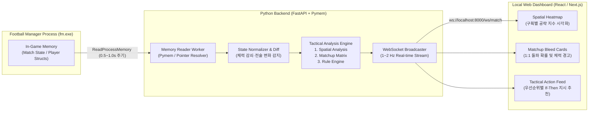

# FM_REA_HeadCoach 시스템 아키텍처 및 핵심 알고리즘 설계서

본 문서는 **풋볼 매니저(Football Manager, 이하 FM)** 실행 프로세스로부터 실시간 데이터를 추출(REA/Memory Reading)하여, 상대의 전술적 약점과 매치업 균열을 수치화하고 즉각적인 전술 지시를 추천하는 로컬 웹 대시보드 시스템의 상세 설계서입니다.

---

## 1. 전체 시스템 아키텍처 (System Architecture)

실시간 메모리 폴링(Polling)의 안정성과 분석 연산의 확장성을 위해 **3-Tier 로컬 파이프라인**으로 구성합니다.



### 1.1 계층별 역할 및 기술 스택
1. **Data Acquisition Layer (`Python Pymem` + `Cheat Engine .CT 호환 파서`)**
   - `fm.exe` 프로세스에 Read-Only 모드로 어태치(Attach)하여 게임 크래시 및 변조 위험을 원천 차단합니다.
   - 버전 패치로 인한 베이스 주소 변경에 유연하게 대응할 수 있도록 **AOB(Array of Bytes) 시그니처 스캔** 및 외부 JSON/CT 오프셋 설정 파일(`offsets.json`) 구조를 채택합니다.
   - **Mock/Simulator 모드 지원**: FM이 실행 중이지 않을 때도 전술 알고리즘을 테스트하고 UI를 검증할 수 있도록 가상 경기 데이터 스트리밍 모드를 함께 제공합니다.
2. **Analysis & API Layer (`Python FastAPI` + `NumPy` + `WebSockets`)**
   - 추출된 원시 스탯(1~20 또는 내부 1~100 스케일)과 실시간 경기 상태(체력, 사기, 경고 여부, 포메이션 좌표)를 정규화합니다.
   - 이전 틱(Tick) 대비 유의미한 상태 변화(예: 상대 풀백 체력 70% 하회, 상대 감독 포메이션 변경)를 감지하고 3대 핵심 알고리즘을 수행합니다.
3. **Presentation Layer (`Next.js / React` + `Tailwind CSS` + `Lucide Icons`)**
   - 듀얼 모니터 또는 오버레이 창에 띄워두고 경기 중 한눈에 직관적으로 파악할 수 있는 다크 테마 전술 상황판 UI를 제공합니다.

---

## 2. 실시간 추출 데이터 스키마 (Memory Target Specification)

메모리 리더가 매 틱(Tick)마다 수집하여 정규화하는 핵심 데이터 구조입니다.

| 분류 | 데이터 필드 | 스케일 / 타입 | 활용 목적 |
| :--- | :--- | :--- | :--- |
| **선수 기본 능력치** | 주력(`Pace`), 순간속도(`Acc`), 민첩성(`Agi`), 균형감각(`Bal`), 점프거리(`Jum`), 몸싸움(`Str`), 지구력(`Sta`) | `1 ~ 20` | 신체적 우위 및 역동작(발목 회전) 계산 |
| **선수 기술 능력치** | 드리블(`Dri`), 퍼스트터치(`Fir`), 패스(`Pas`), 크로스(`Cro`), 태클(`Tck`), 일대일마크(`Mar`), 헤더(`Hea`), 개인기(`Fla`) | `1 ~ 20` | 1:1 돌파·수비 성공률 및 제공권 계산 |
| **선수 정신 능력치** | 오프더볼(`OtB`), 위치선정(`Pos`), 예측력(`Ant`), 판단력(`Dec`), 침착성(`Cmp`), 집중력(`Cnt`), 적극성(`Agg`), 대담성(`Bra`) | `1 ~ 20` | 공간 침투, 수비 라인 유지력, 압박 내성 계산 |
| **실시간 경기 상태** | 현재 체력(`Condition`: `0.0~100.0%`), 경기 평점, 옐로카드 유무(`isBooked`), 현재 피치 위 포지션 슬롯(`SlotID`) | 실시간 변동 | 체력 저하에 따른 실효 능력치 감쇠 및 유혈 지점 트리거 |
| **상대 팀 전술 상태** | 포메이션 배치(`Formation`), 수비 라인 높이(`LineHeight`), 압박 강도(`Pressing`), 수비 폭(`DefWidth`), 성향(`Mentality`) | `1 ~ 5` 단계 (또는 수치) | 중앙 밀집도, 뒷공간 크기, 측면 고립도 산출 |

---

## 3. 핵심 알고리즘 상세 설계 (Core Logic & Mathematical Models)

### 3.1 [모듈 1] 체력 및 경기 상태 기반 '실효 능력치(Effective Stat)' 보정 모델

FM 매치 엔진에서 선수의 **기본 능력치($S_{\text{base}}$)**는 경기 중 **현재 체력($C \in [0, 100]$)**과 **경고 누적 여부($B \in \{0, 1\}$)**에 의해 실시간으로 저하됩니다. 모든 분석에 앞서 실효 능력치($S_{\text{eff}}$)를 먼저 산출합니다.

#### (1) 체력 감쇠 계수 $\gamma(C)$
체력이 $75\%$ 이하로 떨어지는 시점부터 물리적·정신적 능력치(특히 주력, 순간속도, 민첩성, 집중력, 위치선정)에 비선형 페널티를 부여합니다.

$$\gamma(C) = \begin{cases} 1.0 & \text{if } C \ge 75 \\ 1.0 - 0.008 \times (75 - C) & \text{if } 55 \le C < 75 \\ 0.84 - 0.015 \times (55 - C) & \text{if } C < 55 \end{cases}$$

- 예: 체력이 $70\%$일 때 $\gamma(70) = 0.96$, 체력이 $60\%$일 때 $\gamma(60) = 0.88$, 체력이 $50\%$일 때 $\gamma(50) = 0.765$로 급격히 하락합니다.
- **신체/집중력 관련 스탯 실효치**: $S_{\text{eff}} = S_{\text{base}} \times \gamma(C)$
- **기술 관련 스탯 실효치**: $S_{\text{eff}} = S_{\text{base}} \times \left(0.5 + 0.5 \times \gamma(C)\right)$ (체력 영향을 절반만 반영)

#### (2) 경고(Yellow Card) 페널티
수비수가 옐로카드를 보유한 경우($B = 1$), 퇴장 위험으로 인해 실효 태클(`Tck`)과 적극성(`Agg`)에 $15\%$ 감쇠를 적용합니다:

$$S_{\text{eff, Tck/Agg}} = S_{\text{eff}} \times (1 - 0.15 \times B)$$

---

### 3.2 [모듈 2] 상대 수비 블록 및 공백 분석 (Spatial Analysis)

피치를 **6개 핵심 공격 구역**(`좌측 측면`, `우측 측면`, `좌측 하프스페이스`, `우측 하프스페이스`, `중앙 2선(Zone 14)`, `수비 라인 뒷공간`)으로 분할하고, 각 구역의 **공간 취약도 점수(Space Vulnerability Score, $SVS \in [0, 100]$)**를 계산합니다.

#### 측면 및 뒷공간 침투 우위 수식
우리 팀 해당 구역 공격수($A$)와 상대 매칭 수비수($D$, 예: 상대 풀백 + 인접 스토퍼 가중 평균)의 실효 능력치를 비교합니다.

1. **속도 격차 ($\Delta V$, 주력 및 가속도 우위)**:
   $$\Delta V = (0.55 \cdot \text{Acc}_A + 0.45 \cdot \text{Pace}_A) - (0.55 \cdot \text{Acc}_D + 0.45 \cdot \text{Pace}_D)$$

2. **공간 인지 및 침투 격차 ($\Delta M$, 오프더볼 vs 수비 위치선정)**:
   $$\Delta M = (0.60 \cdot \text{OtB}_A + 0.40 \cdot \text{Ant}_A) - (0.50 \cdot \text{Pos}_D + 0.30 \cdot \text{Cnt}_D + 0.20 \cdot \text{Dec}_D)$$

3. **역동작/발목 회전 격차 ($\Delta A$, 방향 전환 반응성)**:
   수비수의 민첩성(`Agi`)과 균형감각(`Bal`)이 낮을수록 높은 수비 라인에서 등 뒤로 넘어가는 패스나 급격한 방향 전환에 역동작이 걸립니다.
   $$\Delta A = (0.60 \cdot \text{Agi}_A + 0.40 \cdot \text{Bal}_A) - (0.65 \cdot \text{Agi}_D + 0.35 \cdot \text{Bal}_D)$$

4. **상대 전술 공간 배율 ($M_{\text{tactic}}$)**:
   - 상대 수비 라인 높이($L_{\text{line}} \in \{1:\text{매우 낮음} \dots 5:\text{매우 높음}\}$), 측면 압박 강도($P_{\text{side}} \in \{1 \dots 5\}$)를 반영합니다.
   - 뒷공간 배율: $M_{\text{behind}} = 0.7 + 0.15 \times L_{\text{line}}$ (수비 라인이 높을수록 최대 $1.45$배 증폭)

5. **최종 구역 공략 지수 ($SVS_{\text{zone}}$)**:
   $$Z_{\text{raw}} = (0.45 \cdot \Delta V + 0.35 \cdot \Delta M + 0.20 \cdot \Delta A) \times M_{\text{tactic}}$$
   $$SVS_{\text{zone}} = \text{clip}\left(50 + 4.5 \times Z_{\text{raw}}, \, 0, \, 100\right)$$

> [!TIP]
> **해석 기준**: $SVS_{\text{zone}} \ge 70$이면 **'핵심 공략 구역(Green/Red Hotspot)'**으로 피치 위에 하이라이트 표시하며, $SVS_{\text{zone}} \le 40$이면 **'공격 자제 구역'**으로 분류합니다.

---

### 3.3 [모듈 3] 매치업 유혈 지점 매핑 (Matchup Matrix & Bleed-Point Detection)

포지션별 1:1 매치업(예: `우리 팀 AMR` vs `상대 DL`, `우리 팀 AML` vs `상대 DR`, `우리 팀 ST` vs `상대 DC`)에 대해 **3가지 공략 확률**을 시그모이드(Logistic Sigmoid) 함수 $\sigma(x) = \frac{1}{1 + e^{-k x}}$로 산출합니다.

#### (1) 온더볼 1:1 돌파 성공 기대 확률 ($P_{\text{dribble}}$)
공격수의 드리블·개인기·민첩성·가속도와 수비수의 태클·일대일마크·위치선정·민첩성을 비교합니다.

$$X_{\text{dri}} = (0.35 \cdot \text{Dri}_A + 0.25 \cdot \text{Acc}_A + 0.20 \cdot \text{Agi}_A + 0.20 \cdot \text{Fla}_A) - (0.35 \cdot \text{Tck}_D + 0.25 \cdot \text{Mar}_D + 0.20 \cdot \text{Pos}_D + 0.20 \cdot \text{Agi}_D)$$

$$P_{\text{dribble}} = \frac{100}{1 + \exp(-0.28 \times X_{\text{dri}})} \quad (\%) $$

- 스탯이 동등할 때($X_{\text{dri}} = 0$) 기본 $50\%$이며, 우리 윙어의 실효 능력치가 수비수보다 평균 $+4$ 높으면($X_{\text{dri}} = +4$) 돌파 기대 지수는 **약 $75.4\%$**로 치솟습니다.

#### (2) 제공권/세컨볼 경합 우위 지수 ($P_{\text{aerial}}$)
타겟맨이나 반대편 윙어의 파포스트(Far-post) 크로스 경합 승률을 계산합니다.

$$X_{\text{air}} = (0.45 \cdot \text{Jum}_A + 0.25 \cdot \text{Hea}_A + 0.20 \cdot \text{Str}_A + 0.10 \cdot \text{Bra}_A) - (0.45 \cdot \text{Jum}_D + 0.25 \cdot \text{Hea}_D + 0.20 \cdot \text{Str}_D + 0.10 \cdot \text{Bra}_D)$$

$$P_{\text{aerial}} = \frac{100}{1 + \exp(-0.30 \times X_{\text{air}})} \quad (\%) $$

#### (3) 압박 유발 시 빌드업 턴오버(실책) 확률 ($P_{\text{press\_trap}}$)
상대 수비수나 수비형 미드필더의 압박 저항력(침착성, 퍼스트터치, 판단력, 패스, 약발 능력)이 낮을 때 전방 압박 타겟으로 지정하기 위한 지표입니다.

$$X_{\text{trap}} = 13.0 - (0.30 \cdot \text{Cmp}_D + 0.25 \cdot \text{Fir}_D + 0.25 \cdot \text{Dec}_D + 0.20 \cdot \text{Pas}_D)$$

$$P_{\text{press\_trap}} = \frac{100}{1 + \exp(-0.35 \times X_{\text{trap}})} \quad (\%) $$

#### (4) 유혈 지점(Bleed Point) 팝업 트리거 조건
다음 조건 중 하나 이상 충족 시 대시보드 최상단에 **실시간 긴급 공략 알림 카드**를 띄웁니다:
- **Trigger A (측면 체력 고갈 및 붕괴)**: $C_D \le 70\%$ 이고 $P_{\text{dribble}} \ge 68\%$ 달성 시
- **Trigger B (경고 누적 수비수 타겟팅)**: $B_D = 1$ (옐로카드 보유) 이고 $P_{\text{dribble}} \ge 62\%$ 달성 시
- **Trigger C (파포스트 미스매치)**: 측면 윙어 vs 상대 풀백의 $P_{\text{aerial}} \ge 72\%$ 달성 시 (예: 키 큰 윙어 vs 단신 풀백)
- **Trigger D (빌드업 구멍 발견)**: 상대 수비진 중 $P_{\text{press\_trap}} \ge 70\%$ 인 선수 존재 시

---

### 3.4 [모듈 4] 전술 지시 가이드라인 자동 생성 규칙 엔진 (Rule-Based Action Generator)

수치화된 공간 점수($SVS$)와 매치업 행렬($P$)을 결합하여, 사용자가 FM 인게임에서 즉시 클릭할 수 있는 **구체적인 전술 지시(Team Instructions / Player Instructions / Opposition Instructions)**로 변환합니다.

| 규칙 ID | 감지 조건 (If) | 추천 전술 지시 (Then - FM 인게임 용어 매핑) | 근거 메시지 출력 예시 |
| :--- | :--- | :--- | :--- |
| **R-01** | 상대 중앙 수비 밀집도 High (3백 또는 2 DM) **AND** $\max(SVS_{\text{left}}, SVS_{\text{right}}) \ge 68$ | **[팀 지시]** 패스 길이: `짧게` → `혼합/다소 길게`<br>**[팀 지시]** 공격 폭: `넓게`<br>**[팀 지시]** `좌/우측 측면 집중 공략` 체크 | "상대가 중앙 밀집형 블록을 형성 중입니다. 공백이 큰 우측 측면($SVS: 74$)으로 공격 방향을 우회하세요." |
| **R-02** | 상대 수비 라인 $L_{\text{line}} \ge 4$ (높음) **AND** $SVS_{\text{behind}} \ge 70$ | **[팀 지시]** `공간으로 패스하라` 활성화<br>**[팀 지시]** 템포: `빠르게`<br>**[개인 지시]** 공격수: `위험을 감수하는 패스` / `라인 침투` | "상대 수비 라인이 높고 센터백의 발목 회전($\Delta A: +3.8$)과 주력이 느립니다. 뒷공간 스루패스 빈도를 높이세요." |
| **R-03** | 상대 특정 풀백(예: DL) 체력 $C \le 70\%$ **AND** 매칭 윙어(AMR) $P_{\text{dribble}} \ge 70\%$ | **[팀 지시]** `우측 측면 집중 공략` + `오버래핑/언더래핑`<br>**[개인 지시]** AMR: `드리블 더 많이`, `측면 넓게 포지셔닝` | "상대 좌측 풀백의 체력이 67%로 저하되어 우측 윙어의 돌파 기대 확률이 76%에 달합니다. 우측 1:1 돌파를 집중 지시하세요." |
| **R-04** | 우리 공격진 평균 $P_{\text{aerial}} \le 42\%$ (제공권 열세) **AND** $\Delta A \ge +2.5$ (민첩성 우위) | **[팀 지시]** 크로스 유형: `낮은 크로스` 또는 `빠른 크로스`<br>**[팀 지시]** `페널티 박스 안으로 공을 투입하라` | "상대 센터백의 제공권($P_{\text{aerial}}: 34\%$)이 압도적이나 민첩성이 떨어집니다. 뜬공 크로스 대신 땅볼(낮은) 크로스로 공략하세요." |
| **R-05** | 반대로 우리 공격진 $P_{\text{aerial}} \ge 68\%$ (제공권 우위) | **[팀 지시]** 크로스 유형: `높은 크로스`<br>**[팀 지시]** `일찍 크로스를 올려라` | "상대 수비진 대비 제공권 우위($71\%$)가 확실합니다. 얼리 크로스와 높은 크로스로 공중볼 경합을 유도하세요." |
| **R-06** | 상대 빌드업 코어(DC/DM) 중 $P_{\text{press\_trap}} \ge 70\%$ 존재 | **[상대 대응 지시]** 해당 선수: `항상 압박(Trigger Press)` + `태클 강하게` + `약발 유도` | "상대 좌측 센터백의 침착성(9)과 퍼스트터치(10)가 낮아 압박 시 턴오버 확률이 74%입니다. 집중 압박 타겟으로 설정하세요." |

> [!IMPORTANT]
> **알림 피로도 방지 (Hysteresis & Cooldown 설계)**:
> 실시간 체력이나 위치가 $69.9\% \leftrightarrow 70.1\%$ 사이에서 진동할 때 팝업이 반복 점멸하는 현상을 막기 위해, 한 번 발동된 규칙은 **최소 3분(인게임 시간 기준) 유지**되며 해제 임계값은 발동 임계값보다 $3\%p$ 낮게 설정(Hysteresis)합니다.

---

## 4. 프로젝트 디렉토리 구조 및 구현 로드맵

프로젝트 루트(`c:\GProjects\FM_REA_HeadCoach`)는 백엔드 분석/메모리 엔진과 프론트엔드 대시보드로 명확히 분리하여 구성합니다.

```text
FM_REA_HeadCoach/
├── docs/
│   └── ARCHITECTURE_AND_LOGIC.md     # 본 아키텍처 및 알고리즘 설계 문서
├── backend/                          # Python FastAPI & Memory Reader
│   ├── app/
│   │   ├── main.py                   # FastAPI 서버 및 WebSocket 엔드포인트
│   │   ├── models/
│   │   │   └── match_state.py        # 선수, 팀, 전술 상태 Pydantic 스키마
│   │   ├── memory/
│   │   │   ├── reader.py             # Pymem 기반 실시간 프로세스 리더
│   │   │   ├── offsets.json          # FM 버전별 메모리 오프셋/포인터 정의
│   │   │   └── simulator.py          # 실시간 경기 시뮬레이터 (테스트/검증용)
│   │   └── engine/
│   │       ├── effective_stats.py    # 체력 감쇠 및 경고 페널티 보정 모듈
│   │       ├── spatial_analyzer.py   # 6개 구역 SVS 공간 공백 계산 모듈
│   │       ├── matchup_matrix.py     # 1:1 돌파/제공권/압박 확률 매핑 모듈
│   │       └── rule_engine.py        # If-Then 전술 지시 자동 생성기
│   └── requirements.txt
└── frontend/                         # Next.js / React 전술 대시보드 UI
    ├── src/
    │   ├── components/
    │   │   ├── PitchHeatmap.tsx      # 6개 구역 공략 지수 피치 시각화
    │   │   ├── MatchupBleedPanel.tsx # 유혈 지점 1:1 매치업 카드 & 팝업
    │   │   └── TacticalGuideFeed.tsx # 실시간 전술 지시 체크리스트
    │   └── app/
    │       └── page.tsx              # 메인 대시보드 레이아웃
    └── package.json
```

### 단계별 진행 계획 (Phased Roadmap)
- **Phase 1 (핵심 분석 엔진 및 시뮬레이터 구축)**: `backend/app/engine/` 산하의 4대 수식 모듈과 실시간 경기 흐름(체력 감소, 경고 발생, 상대 전술 변화)을 재현하는 시뮬레이터 및 FastAPI WebSocket 서버 구현
- **Phase 2 (웹 대시보드 UI 구축)**: 피치 구역별 히트맵, 매치업 유혈 지점 카드, 전술 지시 추천 피드를 한눈에 보여주는 로컬 웹 대시보드 구현
- **Phase 3 (Pymem 실시간 메모리 리더 연동)**: Cheat Engine 포인터 체인 및 AOB 스캐너를 연결하여 실제 실행 중인 `fm.exe` 메모리와 실시간 바인딩
